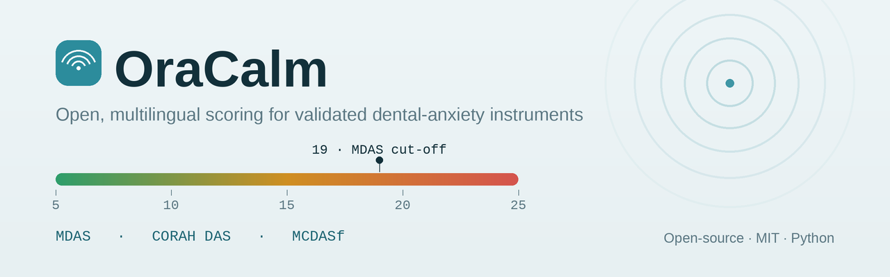

<div align="center">



# OraCalm

**Open, dependency-free scoring for validated dental-anxiety instruments — the Modified Dental Anxiety Scale (MDAS), Corah's Dental Anxiety Scale, and the child faces MCDASf — with multilingual item sets, published cut-offs, and a live web demo.**

[](https://pypi.org/project/oracalm/)
[](LICENSE)
[](https://www.python.org/)
[](tests/)
[](https://doi.org/10.5281/zenodo.21704085)

<sub>dental anxiety · MDAS · Corah DAS · MCDASf · dental phobia · psychometrics · screening · oral health · patient-reported outcome · odontophobia</sub>

</div>

> [!IMPORTANT]
> **OraCalm is an educational and research aid, not a diagnostic device.** It computes published scoring keys for **screening** only. It does not diagnose dental anxiety or phobia, stores no personal data, and never replaces clinical judgement or the original instruments' manuals.

**Contents** · [Why](#why-oracalm) · [Instruments](#instruments) · [Install](#install) · [Python API](#quick-start-python) · [CLI](#command-line) · [Web demo](#web-demo) · [Provenance & licensing](#provenance--licensing) · [Publishing & DOI](#publishing--doi) · [Cite](#citing-oracalm) · [References & prior work](#references--prior-work)

---

## Why OraCalm

Dental anxiety is common, frequently under-detected, and measured with well-validated questionnaires — yet those instruments live in PDFs and journal appendices, and every project re-implements the scoring by hand. OraCalm encodes the **scoring keys, cut-offs, and interpretation bands** of widely used dental-anxiety instruments **once, correctly, and with citations**, as a small dependency-free Python library plus a clean web demo.

The scoring keys and cut-offs are facts; item wording is reproduced from the published instruments with attribution (see [Provenance & licensing](#provenance--licensing)).

## Instruments

| id | Instrument | Population | Items | Range | Validated cut-off | Languages | Source |
|----|------------|-----------|:-----:|:-----:|-------------------|-----------|--------|
| `mdas` | Modified Dental Anxiety Scale | Adults | 5 | 5–25 | **≥19** high anxiety / possible phobia | EN · TR · FA | Humphris et al. 1995 |
| `corah_das` | Corah's Dental Anxiety Scale | Adults | 4 | 4–20 | ≥13 clinically anxious; ≥15 severe | EN | Corah 1969 |
| `mcdasf` | Modified Child Dental Anxiety Scale (faces) | Children ~8–15y | 8 | 8–40 | no single agreed cut-off | EN | Howard & Freeman 2007 |

## Install

```bash
pip install oracalm
# or, from a clone:
pip install -e .
```

## Quick start (Python)

```python
import oracalm

# Score a completed MDAS (one integer per item, in order)
result = oracalm.score("mdas", [3, 3, 4, 2, 5])
print(result.total)        # 17
print(result.band_label)   # 'Moderate dental anxiety'
print(result.flags)        # [] (below the ≥19 cut-off)

# A high-anxiety MDAS
oracalm.score("mdas", [4, 4, 4, 4, 3]).flags
# ['>=19: High dental anxiety / possible dental phobia']

# Interpret a raw total without re-scoring
oracalm.interpret("corah_das", 15)["label"]   # 'Severe anxiety (possible dental phobia)'

# Discover what's available
oracalm.list_instruments()
```

Every `ScoreResult` carries the total, the min/max range, the interpretation band, cut-off flags, and a human-readable interpretation, and serialises with `.to_dict()`.

## Command line

```bash
oracalm list                    # list instruments
oracalm show mdas --lang tr      # print the questionnaire (Turkish)
oracalm score mdas 3 3 4 2 5     # score (space- or comma-separated)
oracalm score das 4,4,4,3
```

```text
$ oracalm score das 4,4,4,3
Corah's Dental Anxiety Scale (Corah DAS)
  Total: 15 / 20  (range 4-20)
  Band:  Severe anxiety (possible dental phobia)
  Flags:
    - >=13: Clinically significant anxiety (per some references)
    - >=15: Severe anxiety / possible dental phobia
  Source: Corah NL (1969). Development of a dental anxiety scale. Journal of Dental Research.
```

## Web demo

A self-contained, mobile-friendly demo lives in [`demo/index.html`](demo/index.html) — pick an instrument, choose a language (MDAS: EN/TR/FA, with right-to-left support for Persian), tap through the items, and watch the score, severity band, and cut-off flags update live. No data leaves the page. Open the file directly, or host it on GitHub Pages.

The interface follows Apple's fluid-design principles — instant press feedback, calm critically-damped motion, translucent materials, optical typography, and full `prefers-reduced-motion` / `-transparency` / `-contrast` support — kept deliberately gentle for an anxiety-sensitive context.

## How scoring works

Each instrument is defined declaratively (see [`oracalm/instruments.py`](oracalm/instruments.py)) as: item stems, response options, total-score range, interpretation bands that tile the whole range, validated cut-offs, and a full citation. The engine ([`oracalm/core.py`](oracalm/core.py)) validates that every response is one of the item's allowed values and that the count matches, sums the responses, resolves the interpretation band, and evaluates cut-offs. The test suite proves that each instrument's achievable min/max equals its declared range and that the bands cover the range with no gaps or overlaps.

## Provenance & licensing

The **software** is MIT-licensed. The **instruments** are the intellectual property of their authors and are reproduced here for educational/research use with attribution:

- **MDAS** — made *freely available for use* by the authors provided the source is cited (official MDAS site, University of St Andrews). English wording is canonical; the **Turkish and Persian** strings are convenience translations and should be checked against the officially validated versions before clinical use.
- **Corah's DAS** (1969) — a classic, widely reproduced 4-item scale.
- **MCDASf** (Howard & Freeman 2007) — faces version of the Modified Child Dental Anxiety Scale (Wong et al. 1998).

If you plan **commercial** redistribution, verify the reuse terms of each instrument with its authors/publisher.

## Roadmap

- IDAF-4C+ (Index of Dental Anxiety and Fear) once reuse terms are confirmed.
- Additional validated language sets (contributions welcome, with a citation per translation).

## Publishing & DOI

Maintainer notes for releasing OraCalm live on GitHub, PyPI, and Zenodo — a full copy-paste walkthrough — are in **[`PUBLISHING.md`](PUBLISHING.md)**. In short: push to GitHub, upload the `assets/social-preview.png` as the repo's social preview, set the GitHub *About* description and topics for discoverability, publish to PyPI, then connect Zenodo and tag a Release to mint a citable DOI (done for v0.1.0 — see the DOI badge above).

## Citing OraCalm

If OraCalm supports your work, please cite the software (see [`CITATION.cff`](CITATION.cff); v0.1.0 is archived at [doi:10.5281/zenodo.21704085](https://doi.org/10.5281/zenodo.21704085)) **and** the original instrument(s) you used (see below).

## References & prior work

Instrument sources were retrieved via **PubMed**; DOIs/PMIDs are linked. Please cite the original instrument(s) alongside OraCalm.

**Methods and instruments it implements**

- Humphris, G.M., Morrison, T. & Lindsay, S.J.E. (1995). The Modified Dental Anxiety Scale: validation and United Kingdom norms. *Community Dental Health* 12(3):143–150. [PMID 7584581](https://pubmed.ncbi.nlm.nih.gov/7584581/) (no DOI)
- Corah, N.L. (1969). Development of a dental anxiety scale. *Journal of Dental Research* 48(4):596. [doi:10.1177/00220345690480041801](https://doi.org/10.1177/00220345690480041801)
- Corah, N.L., Gale, E.N. & Illig, S.J. (1978). Assessment of a dental anxiety scale. *Journal of the American Dental Association* 97(5):816–819. [doi:10.14219/jada.archive.1978.0394](https://doi.org/10.14219/jada.archive.1978.0394)
- Wong, H.M., Humphris, G.M. & Lee, G.T.R. (1998). Preliminary validation and reliability of the Modified Child Dental Anxiety Scale. *Psychological Reports* 83(3 Pt 2):1179–1186. [doi:10.2466/pr0.1998.83.3f.1179](https://doi.org/10.2466/pr0.1998.83.3f.1179)
- Howard, K.E. & Freeman, R. (2007). Reliability and validity of a faces version of the Modified Child Dental Anxiety Scale. *International Journal of Paediatric Dentistry* 17(4):281–288. [doi:10.1111/j.1365-263X.2007.00830.x](https://doi.org/10.1111/j.1365-263X.2007.00830.x)

**Validated translations (check the Turkish and Persian MDAS item sets against these)**

- Tunc, E.P. et al. (2005). Reliability and validity of the Modified Dental Anxiety Scale (MDAS) in a Turkish population. *Community Dentistry and Oral Epidemiology* 33(5):357–362. [doi:10.1111/j.1600-0528.2005.00229.x](https://doi.org/10.1111/j.1600-0528.2005.00229.x)
- Ilgüy, D. et al. (2005). Reliability and validity of the Modified Dental Anxiety Scale in Turkish patients. *Journal of International Medical Research* 33(2):252–259. [doi:10.1177/147323000503300214](https://doi.org/10.1177/147323000503300214)
- Lin, C.-Y. et al. (2021). Psychometric testing of the Modified Dental Anxiety Scale among Iranian adolescents during COVID-19 pandemic. *European Journal of Investigation in Health, Psychology and Education* 11(4):1269–1279. [doi:10.3390/ejihpe11040092](https://doi.org/10.3390/ejihpe11040092)

**Evidence that motivated it (multilingual support)**

- Höglund, M. et al. (2024). Cross-cultural adaptation and validation of the Swedish version of the Modified Dental Anxiety Scale. *Acta Odontologica Scandinavica* 83:666–671. [doi:10.2340/aos.v83.42436](https://doi.org/10.2340/aos.v83.42436)
- Enshaei, Z., Kaji, K.S. & Saied-Moallemi, Z. (2024). Development and validation of the Iranian version of the Children's Experiences of Dental Anxiety Measure (CEDAM). *Clinical and Experimental Dental Research* 10(1):e830. [doi:10.1002/cre2.830](https://doi.org/10.1002/cre2.830)

**Planned instrument (see [Roadmap](#roadmap))**

- Armfield, J.M. (2010). Development and psychometric evaluation of the Index of Dental Anxiety and Fear (IDAF-4C+). *Psychological Assessment* 22(2):279–287. [doi:10.1037/a0018678](https://doi.org/10.1037/a0018678)

## Contributing

Issues and pull requests welcome — especially validated translations (please include a citation) and additional validated instruments. Please keep the library dependency-free and add tests for any new instrument.

## License

[MIT](LICENSE) © 2026 Hossein Boustani Hezarani
